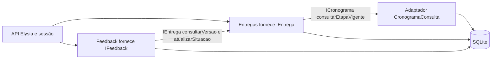

# OrientaTCC

Monorepo (Turborepo + Bun workspaces) do OrientaTCC.

- `apps/mobile` — app Expo (React Native)
- `apps/api` — API Elysia (Bun)
- `packages/typescript-config` — tsconfig compartilhado

## Comandos

```sh
bun install
bun run dev:api      # API em http://localhost:3000
bun run dev:mobile   # Expo
bun run typecheck    # todos os workspaces
```

## Lab 4 — Entregas e Feedback

Implementação dos componentes **Entregas** (`IEntrega`) e **Feedback** (`IFeedback`), conforme UC04, UC05 e UC06 do Lab 3. A especificação está em [docs/lab4/Especificacao-Componentes.docx](docs/lab4/Especificacao-Componentes.docx), acompanhada do [roteiro do vídeo](docs/lab4/ROTEIRO-VIDEO.md) e das [evidências](docs/lab4/evidencias/).

### Tecnologias e estrutura

TypeScript, Bun 1.3.11, Elysia, Drizzle ORM e SQLite. Better Auth fornece a sessão HTTP. Expo e Turborepo já integram o monorepo; não é necessário abrir o aplicativo mobile para demonstrar este lab.

- `apps/api/src/modules/entregas/interface.ts`: contrato IEntrega e porta requerida ICronograma.
- `apps/api/src/modules/entregas/service.ts`: submissão, histórico, consulta, pendências e atualização da situação.
- `apps/api/src/modules/cronograma/interface.ts` e `consulta.ts`: porta de consulta e adaptador responsável pela decisão de vencimento.
- `apps/api/src/modules/feedback/interface.ts` e `service.ts`: pareceres, consultas e leitura.
- `apps/api/src/modules/lab/routes.ts`: validação HTTP e mapeamento de erros.
- `apps/api/src/modules/lab/composicao.ts`: injeção dos serviços reais e resolução da sessão Better Auth.
- `apps/api/src/modules/lab/componentes.test.ts`: testes das operações e integração.
- `scripts/demo-lab4.ts`: demonstração isolada, sem serviço externo.

### Execução reproduzível

Na raiz, com Bun instalado:

```sh
bun install --frozen-lockfile
bun run test:lab
bun run demo:lab
bun run --cwd apps/api typecheck
bun run --cwd apps/api build
```

Testes e demonstração usam SQLite em memória, relógio fixo e dados próprios; não alteram o banco de desenvolvimento e não enviam e-mails. O arquivo mínimo usado como fixture testa transporte e persistência; não representa um TCC para leitura em visualizador PDF.

Para executar a API com persistência:

```sh
cd apps/api
cp .env.example .env
bun run db:migrate
bun run db:seed
MONITOR_PRAZOS_CRON=off bun run dev
```

Consulte `http://localhost:3000/docs`. As credenciais locais do seed são `carlos.lima@exemplo.edu.br` (aluno) e `ana.souza@exemplo.edu.br` (professor), senha `senha123`. Faça login em `POST /api/auth/sign-in/email` e use o token retornado em `Authorization: Bearer <token>`. Os IDs do ator vêm da sessão, nunca do corpo da requisição.

### Interfaces e operações

| Interface | Operação | HTTP |
|---|---|---|
| IEntrega | submeterEntrega | POST /entregas |
| IEntrega | listarVersoes | GET /entregas/versoes?trabalhoId=1&etapaId=1 |
| IEntrega | consultarVersao | GET /entregas/versoes/:id |
| IEntrega | listarEntregasPendentes | GET /entregas/pendentes |
| IEntrega | atualizarSituacao | interna, requerida por Feedback |
| IFeedback | registrarFeedback | POST /feedbacks |
| IFeedback | consultarFeedback | GET /feedbacks?trabalhoId=1 |
| IFeedback | marcarFeedbackLido | PATCH /feedbacks/:id/lido |

Submissão: `{ "trabalhoId": 1, "etapaId": 1, "arquivo": { "nome": "tcc.pdf", "conteudoBase64": "<PDF codificado em base64>" } }`.
Parecer: `{ "versaoId": 1, "parecer": "revisar", "comentarios": "Detalhar metodologia" }`.

PDF de até 2 MiB, base64 canônico e assinatura `%PDF-`; essa checagem não valida toda a estrutura do PDF. O conteúdo fica no campo `versoes.arquivo` como data URI, retornado na consulta autenticada da versão. Não há upload para serviço externo. O nome não pode conter separadores de caminho.

### Comunicação e decisões arquiteturais



A comunicação é uma chamada síncrona TypeScript com injeção pelo construtor. Feedback importa apenas o contrato IEntrega e não consulta tabelas de versões ou entregas. A composição entrega a mesma conexão Drizzle aos dois serviços: inserir feedback e atualizar situação fazem parte da mesma transação SQLite. Isso garante rollback conjunto neste monólito; um adaptador remoto exigiria outro mecanismo de consistência.

Refinamentos do Lab 3: IEntrega ganha `atualizarSituacao` para permitir a mudança de status exigida por UC05 sem romper o encapsulamento; `consultarEtapaVigente` recebe o ID da etapa escolhida e a data de referência e devolve `prazoVencido`, calculado por Cronograma; aceita etapa vencida, conforme UC04 A1. A API acrescenta o ator autenticado aos contratos para validar participação no trabalho. Cronograma é apenas um adaptador de leitura, não um terceiro componente integralmente implementado.

Os módulos preexistentes de Monitor de Prazos e Notificação pertencem a uma modelagem anterior e **não compõem esta entrega**: o Lab 3 fornecido removeu notificações. Foram preservados para não apagar trabalho existente. Feedback é agora um componente independente, embora seu schema permaneça no arquivo de tabelas já existente `db/schema/entregas.ts`. O status é armazenado por entrega/etapa, não por versão; consultar uma versão antiga retorna a situação atual da entrega.

### Testes e resultados

Em 08/10/2026, Bun 1.3.11: **16 testes do lab aprovados, 47 asserções**, typecheck e build da API aprovados. Cobertura de cenários: versionamento e preservação de bytes; prazo e meia-noite no fuso de São Paulo; arquivo inválido; permissões; etapa inexistente; cronograma não publicado; trabalho concluído; validação do feedback; leitura idempotente; duplicidade; revisão seguida de aprovação; versão antiga; rollback entre componentes; autenticação e validação HTTP. Não foi medida cobertura percentual.

A suíte completa (`bun run test:api`) teve **76 aprovados e 1 falha** em teste preexistente do Monitor de Prazos: a deduplicação compara a data fixa de setembro usada pelo teste com a data real de criação da notificação. O registro completo está em `docs/lab4/evidencias/testes-completos.txt`. Esse módulo está fora dos dois componentes selecionados. O teste HTTP do lab injeta um resolvedor de sessão; o Better Auth real tem sua suíte própria preexistente.

Limitações: sem tela mobile nova; PDF limitado e persistido no banco; consulta de feedback faz filtragem em memória (adequada ao volume do lab); histórico de feedback é imutável com um parecer por versão; avaliar uma versão antiga é rejeitado. Novas submissões exigem trabalho em orientação; a avaliação pressupõe que o trabalho não seja concluído entre submissão e avaliação. A publicação do repositório e a gravação do vídeo devem ser conferidas antes da entrega.


### Revisão conforme feedback do professor

A arquitetura revisada está em [arquitetura-revisada.puml](docs/lab4/arquitetura-revisada.puml). O arquivo `arquitetura-lab3.puml` preserva o original para comparação. Esta revisão substitui GerenciarTCC por duas responsabilidades:

| Componente | Operações de domínio |
|---|---|
| Proposta / IProposta | submeterProposta, consultarProposta, listarPropostas, verificarLimiteOrientandos, responderProposta |
| TCC / ITCC | consultarTrabalho, listarOrientandos, registrarResultadoFinal |

Proposta decide se o orientador pode aceitar uma nova proposta, usando a lista/contagem de orientandos ativos fornecida por ITCC e um limite configurado. TCC é dono do vínculo e do ciclo de vida do trabalho. Para o futuro aceite, propõe-se `ITCC.criarTrabalhoDePropostaAceita`, chamada por Proposta; a verificação do limite e a criação precisam ser atômicas para evitar exceder a capacidade em aceites simultâneos. Essa operação de integração é um refinamento proposto, **não implementado neste recorte**. Os serviços completos de Proposta e TCC permanecem fora da implementação do Lab 4.

| Conceito | Dono da regra e da escrita | Colaboração |
|---|---|---|
| Datas, prazos e vencimento | Cronograma | Entregas fornece a data de referência e consome `prazoVencido`; não compara datas. |
| Situação da entrega de uma etapa | Entregas | Valida as transições e grava `entregue`, `entregue_com_atraso`, `em_revisao` ou `aprovada`. |
| Parecer, comentários e leitura | Feedback | Registra o parecer e solicita a mudança por `IEntrega.atualizarSituacao`. |

“Estado da etapa” na interface do usuário é a situação da entrega associada à etapa. Não existe uma segunda cópia desse estado em Cronograma. Portanto, prazo vencido não significa automaticamente “Em revisão”: vencimento é uma condição temporal; revisão é um estado de avaliação. Um parecer de revisão não altera o prazo.

### Catálogo de reuso revisado

Nível descreve o **escopo reutilizado**; estratégia descreve **como reutilizamos**. Usar um framework não implica reutilizar uma aplicação pronta ou um componente de domínio inteiro. O catálogo adota a taxonomia do formulário (aplicação, componente, objeto/função); a classificação abaixo se refere ao uso delimitado no OrientaTCC.

| Item | Necessidade reformulada | Escopo e nível de reuso | Estratégia |
|---|---|---|---|
| 1 Better Auth | Prover credenciais e sessões com integração às permissões do domínio | Subsistema de autenticação encapsulado por IAutenticacao; componente de infraestrutura | Framework |
| 2 Expo | Construir, executar e empacotar o aplicativo mobile | APIs, módulos e convenções de desenvolvimento; objeto/função no recorte adotado, não uma aplicação pronta | Framework e ferramentas |
| 3 Elysia | Construir rotas HTTP, validar entradas e compor a API | Classes, funções e plugins de infraestrutura HTTP; objeto/função no recorte adotado | Framework |
| 4 Drizzle ORM | Mapear tabelas e executar consultas e transações | Tipos e funções de persistência; objeto/função | Biblioteca |
| 5 Resend | Entregar e-mails transacionais, se o escopo exigir | Serviço externo acessado por IEmail; componente de infraestrutura externo | Serviço/API |
| 6 Turborepo | Coordenar tarefas e dependências entre pacotes do monorepo | Ferramenta pronta de build utilizada pela equipe; aplicação de apoio ao desenvolvimento, não parte do produto em execução | Ferramenta/CLI |

Resend foi uma oportunidade considerada no Lab 2 e existe na base anterior. Como as notificações foram removidas do Lab 3, ele não é uma dependência dos componentes entregues neste lab. Expo, Elysia e Turborepo são infraestrutura de construção/desenvolvimento; não são componentes funcionais como Entregas e Feedback.

Critérios de avaliação a registrar para cada candidato, sem atribuir notas não verificadas:

| Critério | Evidência a coletar e impacto na decisão |
|---|---|
| Adequação e compatibilidade | Recursos necessários, TypeScript/Bun/Expo e restrições de versão; validar com prova de conceito. |
| Maturidade | Histórico de versões, estabilidade das APIs, manutenção e política de correções. |
| Comunidade | Documentação, exemplos, atividade dos mantenedores e respostas a problemas relevantes. |
| Baixo acoplamento | Contar dependências de SDK no domínio; manter DTOs e portas próprias na fronteira. |
| Possibilidade de substituição | Identificar adaptadores, migração de dados e mudanças de configuração necessárias. |
| Custo e restrições | Licença, limites de uso, operação, serviço externo e impacto em dados pessoais. |

Plano de substituição: Better Auth pela implementação de IAutenticacao; Resend por IEmail; Elysia mantendo os serviços e substituindo rotas; Turborepo substituindo a orquestração por scripts. Drizzle está diretamente nos serviços atuais, logo sua troca exige refatoração de persistência e novos testes — ainda não há isolamento completo por repositórios. Expo tem impacto em empacotamento e módulos nativos, portanto sua troca também exige adaptação. Maturidade e comunidade são critérios a verificar com evidências na decisão da equipe, não avaliações já comprovadas nesta revisão.
